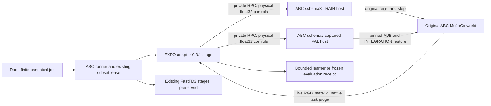

# Ordinary EXPO task-RL host integration

This package combines the schema3 training host with the current ABC benchmark.
It preserves the FastTD3 vector, scratch, and frozen stages from ABC `8d816206`.
It also preserves the schema2 captured validation reset.

The existing subset allowlist already accepts `expo_abc_adapter.stage`.
The EXPO package validates its phases. ABC needs no new module or phase entry.
The coordinator passes `--config` and an owned `--output` directory.
The EXPO stage supervises its host in the canonical process group.

EXPO 0.3.1 separates compile capacity, executed-update capacity, ordinary task-RL,
and frozen post-RL evaluation. A capacity result is not a task success result.
The training host uses the explicit
`original_five_variant_scale_armcarry_v1` reset profile.
It sends original float32 commands without host clipping.
Schema1 keeps its historical clipping behavior.
Schema2 keeps its captured physics and live camera admission gates.

This agent owns the isolated package merge and CPU package checks.
Root owns release installation, the GPU lease, and all native method runs.
CPU tests use explicit task or camera doubles where documented.
Tiny real MuJoCo tests verify the saved model and integration boundary.
They do not prove native live camera rendering or policy learning.

Build a normal wheel before release. Test its installed package from an external
directory with `python -I -B -m pytest --import-mode=importlib`.
The release audit must bind all Python payloads, model assets, and installed
RECORD entries. Compare preserved files with ABC `8d816206`.
Root must run the actual EXPO capacity and task-RL stages after admission.

This text uses ASD-STE100 guidance. It has not had a full compliance check.
