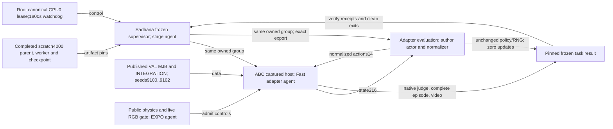

# Frozen FastTD3 validation

`abc_bench.fasttd3_frozen_stage --config CONFIG.json --output OUTPUT` tests one
declared captured validation scene. Run it through the canonical GPU0 runner.
Run seeds9100,9101 and9102 in separate serial jobs. Each parent has an1800s bound.

The stage authenticates the completed4000-step training parent and worker.
It binds the original export to512000 transitions,7978 critic updates and3989
actor updates. It requires clean exits from both leaders and all128 workers.
It checks installed host payloads and the original12 Fast source files before
it constructs a native scene. The previous64 and4000 supervisors stay unchanged.

The public captured host restores the declared MJB and full INTEGRATION state.
It checks initial physics, the native judge and actual live RGB before controls.
The stage checks the complete reset proof before it starts the actor consumer.
The actor receives privileged float32 state216. It receives no camera inputs.
Normalized actions14 use the same affine map and clipping as scratch training.

The consumer uses the adapter evaluation loop with the original author Actor
and EmpiricalNormalization. It preserves saved AMP and normalization precision
settings. It does not call the nested evaluation function inside author train.py.
The original author learner and protected update ASTs remain unchanged.

The stage requires equal persistent actor/normalizer hashes and CPU/CUDA RNG
hashes before and after evaluation. It requires zero optimizer updates. A failed
episode must complete all3540 controls. A successful episode can end earlier.
The native five-bottle judge supplies success. Actual episode video and the
initial reset proof must bind to the host and learner receipts.

Prepare each configuration after training has completed. Call the installed
`prepare_config(training_parent, training_worker, host_config, source_pins)`.
Write the returned JSON to a new file. Do not pin a running producer receipt.
Use the exact captured host configurations and source inventory in the handoff.
The stage allows readiness300s, learner1400s and shutdown30s. It keeps both
children in the canonical process group and removes its private0700 socket.

Root owns normal installation, GPU admission and serial native evaluation.
The Fast adapter agent owns the native host and actor consumer. The stage agent
owns supervision and artifact checks. The EXPO agent owns the public captured
reset gate. CPU tests use explicit child and artifact doubles. Native scores
remain unavailable until the actual jobs complete. Three scenes support a
small diagnostic result, without a population, paper reproduction or R1Lite claim.

The implemented connections are shown above. This diagram does not prove native
task performance. This text uses STE guidance. Formal ASD-STE100 compliance was
not checked.
