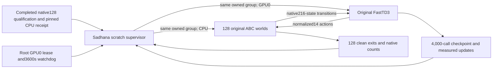

# Bounded FastTD3 scratch training

`abc_bench.fasttd3_scratch_stage --config CONFIG.json --output OUTPUT` runs a
separate 4,000-call scratch phase. The old 64-call supervisor stays unchanged.
Use this module through the canonical GPU0 subset runner.

The stage requires the completed canonical128-world qualification parent,
worker, native collector, original learner and checkpoint pins. It also
requires the exact configuration that qualified the two CPU worlds. New
host and adapter payload pins identify this separately named scratch phase.
The normal installed original12 Fast modules, four protected function AST
hashes and dependency versions are checked before new worlds start.

This phase preserves original128-world/B32768/replay51200/BF16/compiled
learning settings. It allows4,000 vector calls,512,000 native transitions,
7,978 critic updates and3,989 actor updates. It starts from scratch and does
not resume the short capacity run. Original optimizer/update code is unchanged.
Ready600s, learner2700s and shutdown30s fit the3600s host and parent bounds.
Fresh RAM admission and clean128-worker exits remain required.

The stage checks the exported actor, critics and normalizers. The export does
not contain optimizer, replay or RNG state. Exact continuation is unavailable.
This is a bounded single-seed training measurement. It does not establish
convergence, a frozen task score or reproduction of a paper's benchmark.

Root owns normal installation and GPU admission. The Fast adapter agent owns
the public native host/client. The stage agent owns supervision. The next
separate release will supervise frozen evaluation of this exact checkpoint
on captured VAL scenes, with the published live physics/RGB gate. That
evaluation supervisor is planned here and is not yet delivered.

This text uses STE guidance. Formal ASD-STE100 compliance was not checked.
