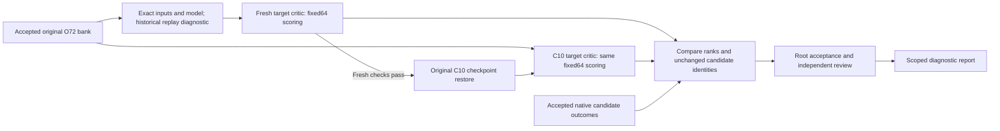

# Compare two critics on one saved action bank

**Both critics select a failing window in this acquisition diagnostic.** C10
changes the preferred candidate from 44 to 41. Native testing confirms that
41 also fails the unchanged sampled lift/contact criterion. Passing candidates
12 and 14 remain available in the same bank. This shows a local selection
limitation after ten original update calls, without establishing its cause.

[Watch the verified native comparison](/home/user/aditya/RL/builds/r1lite-acquisition-20261019/visuals-04/comparison.mp4).
The video shows the reference, both selected windows, and passing alternative 12.
It uses recorded frames at 15 fps, with no action or video smoothing.

The accepted comparison completed on 19 October 2026 in 378.200 seconds.
Both critics scored the identical 64 saved windows twice. Each repeated output
matched exactly. Root authenticated 69 arrays. The original optimizer counters,
parameters, and random state stayed unchanged during scoring. GPU 0 was released.
[Root acceptance](/home/user/aditya/RL/builds/r1lite-realtime-expo-20261014/fixed-bank-scoring-execution-05/ROOT_ACCEPTANCE.json).

| Candidate | Fresh Q | C10 Q | Recorded acquisition outcome |
| --- | ---: | ---: | --- |
| 0 | -0.553507 | -0.939663 | Fail |
| 44, edited from 12 | -0.420629 | -0.935201 | Fail |
| 12 | -0.453844 | -0.932551 | Pass |
| 14 | -0.578783 | -0.949624 | Pass |
| 41, C10 winner | -0.532498 | -0.909228 | Fail |

Scores are values from the target critic, not probabilities. Their absolute
change does not establish a physical-performance change. Four outcomes were
available before scoring; candidate 41 was executed afterward. The fresh
winning margin is 0.033215; the C10 margin is 0.011317. C10 ranks passing 12
above failing 44, but ranks passing 14 below all three measured failures. This pairwise
change does not improve its selected acquisition outcome. The forced continuation and acquisition
criterion differ from the original policy return. This is not a general test
of critic calibration.

Candidate 41 completed 112 native controls in 22.844 supervised seconds. All
73 prefix observations matched the source. The eight replacement commands came
from the original physical bank; subsequent commands matched the common recording.
Its minimum rise was approximately zero, with bilateral loaded contact at 0/9
samples. No replacement command clipped; five common continuation commands clipped.
Historical reward remained zero at this partial horizon. Root and independent
review authenticated all 41 saved frames and recomputed the outcome.
[Native acceptance](/home/user/aditya/RL/builds/r1lite-acquisition-20261019/scored-winner-01/ROOT_ACCEPTANCE.json).

The next learning test should increase original updates on fixed data, with a
retained checkpoint and frozen evaluation. Do not interpret ten calls as a
convergence budget. Do not add memory or change rewards at the same time.
The existing full checkpoint occupies 15.15 GiB; current free space is about
11 GiB. The configured training admission requires 82.945 GiB. That training
run remains pending persistent capacity; no checkpoint or baseline was deleted.

This diagnostic asks whether the trained C10 critic ranks a known passing
acquisition window above a known failing window. It changes no author learner code.
The scorer performs no training or simulator controls. The separate native
consumer supplies physical outcomes. The full-task benchmark remains separate.

The accepted TRAIN21000 O72 bank contains 32 base windows and 32 edited windows.
Each window contains eight 14-coordinate commands. Native tests of candidates
0, 44, 12, and 14 used identical physical prefixes and recorded continuations.
Candidates 12 and 14 passed the sampled lift/contact criterion. Candidates 0
and 44 failed. Candidate 44 is an edit of candidate 12.

The scorer loads the unchanged author's initialized model and accepted C10
checkpoint. C10 contains ten original update calls and 200 critic updates.
It uses the original target critic, encoder, head sampling, and selection code.
Both models receive the same saved candidates and selector random key.
This isolates checkpoint differences on this bank. It does not sample the
trained actor or editor, or reproduce the complete online policy.

## Validation and numerical scope

The first attempt required bitwise score equality between two compiled paths.
It failed before C10 restore. The fixed64 path preserved every candidate,
state, selected command, and winning index. Encoder and Q values differed.
Maximum differences were 0.001967713 and 0.001288295, respectively.
Sixteen rank positions changed, with ten pairwise order reversals.
The winning candidate and the order of the four tested candidates remained
unchanged. Preserve this attempt as failed.

Version 2 matched all eight parameter digests but failed its exact original
selector replay. Therefore, changing the number of candidates was not the only
unresolved difference. The diagnostic supplied only the active camera entry;
the original call supplied the complete image dictionary. Reloaded proposals
also lacked explicit original inference sharding. Both failed attempts remain
recorded, and neither loaded C10.

Version 3 restored those input conventions. All transformed tensors and eight
parameter digests matched exactly. It still failed the cross-process bitwise
score check. Its maximum differences were 0.001967713 for encoder features,
0.001288295 for Q, and 0.000098109 for normalized edited actions. Base proposals,
random keys, state tensors, and the winning index matched exactly.

Version 4 then used numerical limits. It also stopped before C10: the Q
replay difference reached 0.002371669, above its 0.002 limit. Its winning
candidate remained 44. These limits were fitted to earlier diagnostic runs;
they did not establish a general cross-process reproducibility guarantee.
All four attempts retain failed status. None is evidence of a C10 learning
failure, because none reached C10 scoring.

Version 5 corrects the experiment contract. Historical replay and historical
score differences are descriptive diagnostics. They do not gate the comparison.
The scientific comparison requires both models to score the identical saved
bank under the same observation and target-head draw. It requires:

- Exact fresh parameter digests and complete transformed-observation identity.
- Exact saved base proposals, random keys, and state tensors during replay.
- Exact saved candidate and flattened-action tensors during fixed64 scoring.
- The original sampled target heads, IDs 6 and 4.
- Finite scores and consistent score shapes, argmax, and selected commands.
- Two identical outputs from repeated fixed64 calls within each model stage.
- Unchanged parameters, optimizer counters, and learner random state per stage.

The original replay regenerates edits once for diagnostics. Those edits never
replace the accepted candidate bank. Each model scores that saved bank twice
with editing disabled. The fresh model's historical winner and ranking may
change; those changes are reported rather than silently rejected.

After the fresh stage passes the current checks, the original restore function
loads C10 step 10. The inference cache is rebuilt from restored parameters.
C10 can select a different candidate from the same bank. No model is updated.

XLA documents that separate compilations can choose different GPU kernels and
produce different floating-point results. That mechanism is plausible here;
the specific kernel cause has not been isolated. This comparison makes no
universal numerical-error or cross-process bitwise reproducibility claim.
[OpenXLA GPU determinism](https://openxla.org/xla/determinism).

The C10 result is a fixed-bank score comparison. It is not proof that the
original trained online selector would generate or choose these same actions.
If its winner has no measured physical outcome, run that candidate before
assigning an acquisition result.

## Operation and ownership

Use the installed `abc_bench.runner --algorithm author-subset` entrypoint with
the frozen job configuration. The coordinator holds the exclusive GPU 0 lease.
The worker and parent deadlines are 1800 and 1900 seconds. Output is limited
to 64 MiB. The original checkpoint is read only; no checkpoint is saved.

The scorer writes finite arrays, parameter digests, ranks, and comparisons.
`PROGRESS.json` retains completed checks if a later check fails. `RESULT.json`
pins that receipt. Root accepts actual artifacts after canonical cleanup.
Independent review checks source fidelity and numerical results.

The recipe agent owns the scorer. The boundary agent reviews the diagnostic
and owns the native action consumer. Root owns installation, GPU admission,
result acceptance, and publication. Leela owns task physics. This explanation
uses STE guidance; full ASD-STE100 compliance has not been checked.

The diagram shows the diagnostic data flow. It does not establish learned
full-task success, autonomous recovery, or whole-body control.
