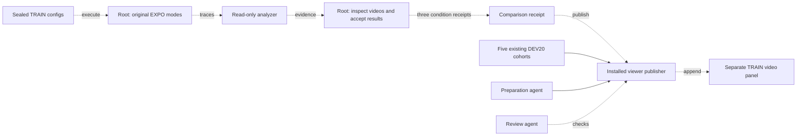

# EXPO inference diagnostics in the R1 Lite viewer

The viewer can show three original EXPO inference modes on four fixed TRAIN
starts. Each mode has its own score and four complete videos. The existing
five DEV20 cohorts and their 100 videos stay in the evaluation panel.

This is an inference diagnosis at seed42 with zero online updates. Each mode
uses the RTC2000 actor and fresh EXPO heads. The modes are full EXPO with edit
scale0.1, the full learner's base-action bypass, and full EXPO with edit scale0
and critic ranking retained. The branches can consume different random streams.
These results do not isolate a causal effect or establish a learning gain.

## Evidence and publication

The installed `abc_bench.report_r1lite_expo` CLI accepts
`--cohort train_diagnostics`. Supply the actual comparison acceptance with
`--acceptance`, the existing viewer directory with `--output-dir`, and a fresh
publication receipt path with `--receipt`.

The comparison must pin three root condition acceptances. Each acceptance must
pin the qualified analyzer result, completed execution records, source and
checkpoint checks, resource cleanup, actual full video decodes, and sampled
frames that root inspected. The analyzer keeps `artifact_accepted=false`;
root records the separate acceptance. CPU fixtures cannot admit an experiment.

All five videos per mode require decode checks, including the unscored startup
seed20999. Only scored seeds21000–21003 enter the viewer. The publisher uses the
existing lock, content hashes, backups and atomic JSON replacement. It rejects
a second publication to this slot. The panel stays hidden when data is absent.

Root receipt templates and the sealed experiment configuration are under
`/home/user/aditya/RL/builds/r1lite-realtime-expo-20261014/` in
`expo-four-start-viewer-preparation-20261015/` and
`newgap-multistart-preparation-20261015/`.

## Verification on 15 October 2026

Root built a normal wheel and installed it in a fresh copied Python prefix.
All51 viewer package payloads match source, wheel and installed bytes. Only
the publisher and HTML template changed in production. The installed checks
passed:16 publisher methods,6 export methods and35 Node DOM cases. The cases
use explicit synthetic media; they do not test actual playback or task success.
Actual experiment publication and browser checks are pending at this revision.

The tests preserve all five historical result objects and100 video references.
They also check missing acceptance, changed inputs, malformed outcomes, media
identity, locking, collisions, duplicate publication and refresh state.

Root owns execution and acceptance. One agent prepared the viewer; another
agent reviewed it. Root ran the installed checks. The diagram below shows the
planned experiment handoff. The explanation uses STE guidance; full ASD-STE100
compliance was not checked.

