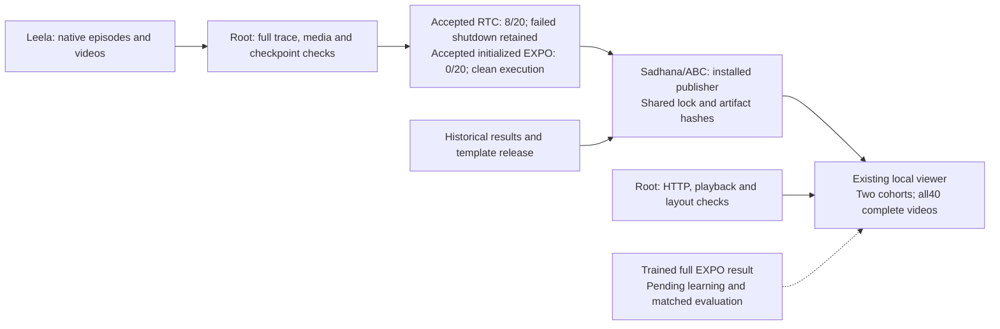

# R1 Lite results in the original-methods viewer

The local viewer now includes 20 complete RTC DEV episodes and 20 complete
initialized full EXPO DEV episodes. Use the cohort selector to choose the policy.
Open <http://127.0.0.1:8770/original-methods/#r1lite-heading>.
The selector starts with seed9100, a timeout. All 8 successes, 11 timeouts and
one early failure remain available in the original evaluation order.

The score is 8/20 for RTC-SFT checkpoint 2000, which contains 2,001 updates.
This is EXPO's base policy before online RL. Initialized full EXPO scored 0/20:
all 20 episodes reached the 900-control timeout. It uses the same RTC2000 actor
weights, fresh editor and critics, and the original 32 base plus 32 edited
candidates. It has zero learning updates. The full EXPO after-learning score
remains pending. The RTC shutdown failure and separate artifact acceptance stay
visible. The initialized run has clean completed canonical and worker receipts.

The installable `abc_bench.report_r1lite_expo` command authenticates root acceptance,
its read-only evidence, every scored video and its sidecar. It copies full recordings
under their content hashes. It holds the existing viewer publication lock,
preserves historical result fields, and records the previous template release.
It exports the packaged HTML and records the new served template hash.
It does not start a simulator, import a learner, or change a running experiment.

```sh
python -I -B -m abc_bench.report_r1lite_expo \
  --acceptance /absolute/RTC_DEV20_ROOT_ACCEPTANCE.json \
  --output-dir /absolute/existing/original-methods \
  --receipt /absolute/fresh/PUBLICATION.json
```

For the initialized cohort, add `--cohort initialized_full_expo` and use
`INITIALIZED_DEV20_ROOT_ACCEPTANCE.json`. The default remains RTC. The new path
authenticates root and read-only acceptance, the original initialization recipe,
source and native event hashes, clean execution, and all 21 decoded media records.
Startup seed9001 is excluded; all 20 scored videos are published. The publisher
trusts the pinned acceptance for the large actor checkpoint files. It rechecks
the smaller source, execution, native and media artifacts.

The isolated installed publisher passed actual-data and lock-contention checks.
A competing process failed without writing while the lock was held.
All historical score fields remained unchanged after publication.
Actual HTTP byte-range checks and browser metadata checks passed for all 40 videos.
The new browser check played RTC seed9101 and initialized EXPO seed9100.
The earlier check also played the first RTC timeout. Desktop and mobile
screenshots were inspected; no page error or mobile overflow was observed.
These checks verify publication. Scientific acceptance remains separate.

Seven installed publisher tests passed. They include rejected changed source or
media, mismatched native length, inconsistent root observations, failed execution,
held-lock contention, and preservation of historical results. The first browser
check failed when it read text inside a closed details panel. The corrected check
opens the panel before reading it. Product bytes did not change for this correction.

These checks use the real accepted experiment files. They are an explicit
integration check, excluded from default unit-test discovery. Set the fixture
paths if the accepted files are at another location, then use the installed
publisher environment:

```sh
R1LITE_INITIALIZED_ACCEPTANCE_FIXTURE=/absolute/INITIALIZED_DEV20_ROOT_ACCEPTANCE.json \
R1LITE_VIEWER_FIXTURE=/absolute/prior-viewer \
CUDA_VISIBLE_DEVICES= /absolute/prefix/bin/python -I -B -m unittest discover \
  -s /absolute/abc/tests/bench -p verify_report_r1lite_initialized.py -v
```

Evidence root: `/home/user/aditya/RL/builds/r1lite-realtime-expo-20261014/`.
The `viewer-release-01/` directory contains `INSTALLED_QUALIFICATION.json`,
`PUBLICATION.json`, `BROWSER_RESULT.json`, screenshots and the isolated wheel.
Independent source review is in `r1lite-viewer-source-review-20261015/`.
The initialized extension has a separate review in
`initialized-viewer-review-20261015/`. Its actual publication, all40 browser checks,
screenshots and visual acceptance are in `viewer-release-02/`.
`viewer-release-03/` contains the final formatted wheel and seven passing installed
tests. Its production AST and served HTML are unchanged from the reviewed release.
The active supervisor and EXPO runtime were not replaced for this UI change.



Root executed and accepted publication. The independent agent reviewed source
and found the missing publication lock and stale template metadata. Both were fixed.
Leela owns simulation; Sadhana owns training and result publication.
This explanation uses STE guidance. Full ASD-STE100 compliance is unchecked.
