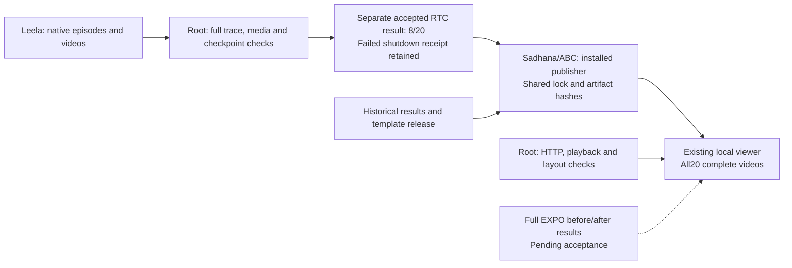

# R1 Lite results in the original-methods viewer

The local viewer now includes all 20 complete RTC DEV episodes.
Open <http://127.0.0.1:8770/original-methods/#r1lite-heading>.
The selector starts with seed9100, a timeout. All 8 successes, 11 timeouts and
one early failure remain available in the original evaluation order.

The score is 8/20 for RTC-SFT checkpoint 2000, which contains 2,001 updates.
This is EXPO's base policy before online RL. The full EXPO before-learning
and after-learning results remain pending. The failed shutdown supervision
and separate artifact acceptance remain visible in the evidence details.

The installable `abc_bench.report_r1lite_expo` command authenticates root acceptance,
its read-only evidence, every scored video and its sidecar. It copies full recordings
under their content hashes. It holds the existing viewer publication lock,
preserves historical result fields, and records the previous template release.
It exports the packaged HTML and records the new served template hash.
It does not start a simulator, import a learner, or change a running experiment.

```sh
python -I -B -m abc_bench.report_r1lite_expo \
  --acceptance /absolute/RTC_DEV20_ROOT_ACCEPTANCE.json \
  --output-dir /absolute/existing/original-methods \
  --receipt /absolute/fresh/PUBLICATION.json
```

The isolated installed publisher passed actual-data and lock-contention checks.
A competing process failed without writing while the lock was held.
All historical score fields remained unchanged after publication.
Actual HTTP byte-range checks and browser metadata checks passed for all 20 videos.
The browser played the first timeout and first success. Desktop and mobile
screenshots were inspected; no page error or mobile overflow was observed.
These checks verify publication. Scientific acceptance remains separate.

Evidence root: `/home/user/aditya/RL/builds/r1lite-realtime-expo-20261014/`.
The `viewer-release-01/` directory contains `INSTALLED_QUALIFICATION.json`,
`PUBLICATION.json`, `BROWSER_RESULT.json`, screenshots and the isolated wheel.
Independent source review is in `r1lite-viewer-source-review-20261015/`.
The active supervisor and EXPO runtime were not replaced for this UI change.



Root executed and accepted publication. The independent agent reviewed source
and found the missing publication lock and stale template metadata. Both were fixed.
Leela owns simulation; Sadhana owns training and result publication.
This explanation uses STE guidance. Full ASD-STE100 compliance is unchecked.
