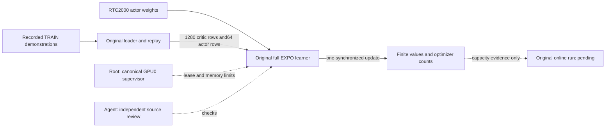

# Original EXPO update capacity check

The R1 Lite online run failed before its first update completed. The author
launcher uses four GPUs. Our authorized run placed the global batch on GPU0.
This diagnostic tests one original update with host-backed CUDA unified memory.
It is not an online training run or a task-success benchmark.

`abc_bench.realtime_update_probe` uses the original model factory, dataset
loader, replay buffers, batch processor and learner. It retains batch64,
UTD20, horizon16, delay5, replan8 and the original candidate counts.
The input is the existing21 synthetic TRAIN demonstrations. RTC2000 supplies
actor weights; heads and optimizers start fresh. The diagnostic omits collection
and calls the original update once. No policy checkpoint is saved.

The BFC allocator uses unified memory, fraction1.5 and no preallocation.
The worker requires160GiB available host RAM at admission and stops below48GiB.
Its deadline is2300seconds; canonical supervision reserves2400seconds.
Only the existing GPU0 lease can admit execution. A completed update must have
finite returned parameters, optimizer state and metrics, with the original
counter increments. This check does not establish full online memory capacity.

Root ran44 installed CPU checks; all passed. Eight unrelated Torch guards were
deselected. The original learner and replay source remain unchanged. The server
receives a small normal wheel containing the diagnostic and its lease boundary;
ABC simulator and Torch dependencies are not installed into that environment.

The frozen configuration and evidence are in
`../builds/r1lite-realtime-expo-20261014/online-memory-probe-release-01/`,
relative to this repository. Run only through the installed canonical runner:

```sh
ABC_BENCH_REPO=/home/user/aditya/RL/abc .venv/bin/python -I -B -m abc_bench.runner \
  --algorithm author-subset \
  --training-config /home/user/aditya/RL/builds/r1lite-realtime-expo-20261014/online-memory-probe-release-01/PROBE_JOB.json \
  --timeout-seconds 2400 --seed 42
```



Root owns execution and acceptance. Agents prepare and review source.
This text uses STE guidance; full language compliance is unchecked.
