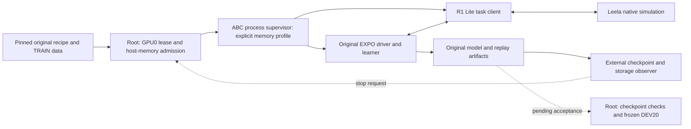

# Original online EXPO with unified memory

The first R1 Lite online attempt failed at its first original update. The
author launcher uses four GPUs. Our authorized run uses GPU 0 alone. Batch 64
therefore places more work on one device. This does not establish an algorithm
failure.

A separate diagnostic completed one original B64/UTD20 update on GPU 0.
The actor, editor and temperature advanced once. The critics and encoder
advanced 20 times. Checked returned state and scalar metrics were finite.
The update took 105.66 seconds; total job time was 320.37 seconds.
It saved no policy and measured no task success. See
[the diagnostic](REALTIME_EXPO_MEMORY_PROBE.md).

The opt-in `original_online_bfc_unified_v1` supervisor profile permits the
original `train_pi_robo.py` to use the same memory settings. It requires BFC,
unified memory, fraction 1.5, and disabled preallocation. It pins the installed
JAX defaults used by the diagnostic and removes conflicting inherited settings.
It preserves the leased GPU UUID. It changes no learner, driver, replay or
update schedule.

Admission requires 160 GiB available host memory. Monitoring fails below
48 GiB or when memory cannot be observed. On a monitoring failure, cleanup
stops the author process before the client. Other cleanup paths keep their
existing order. These checks do not reserve host memory or prevent an immediate
allocation spike.

The original worker and parent limits remain 21,600 and 21,700 seconds.
The separate checkpoint observer retains the existing storage and saved-model
stop conditions. A controlled stop does not establish natural completion.
Root must accept the saved model, replay, optimizer state and process cleanup.

The full online run remains pending. The isolated diagnostic omits concurrent
native control and live inference caches. Its allocator statistics do not
measure physical VRAM peak or host spill. Full online capacity and policy
improvement require separate measurements.

Root owns installation, execution and result acceptance. Agents prepare source
and review changes. Sadhana owns RL; Leela owns simulation. This text uses
ASD-STE100 guidance. Full language compliance was not checked.
