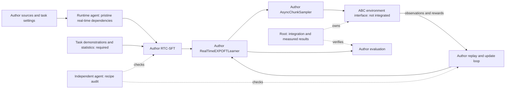

# Author recipe versus executed diagnostics

## Current correction — 13 October 2026

The user requires **Real-Time EXPO-FT**, with the authors' implementation.
The standard EXPO campaign is stopped. The custom FastTD3 ABC campaign is on
hold. Earlier correction steps below are historical and do not authorize those
campaigns to resume.

The central error was treating unchanged learner functions as sufficient
evidence of method fidelity. Data, reward, action timing, replay sampling,
update frequency, initialization and stopping rules also define the experiment.
Our ABC runs changed several of these together. They cannot establish that the
published methods fail. More compute alone does not correct that comparison.

### What was wrong

| Component | Actual ABC experiment | Required correction |
| --- | --- | --- |
| EXPO method | Standard `EXPOLearner`, delay 0, custom serial driver | Author `RealTimeEXPOFTLearner` and original driver/sampler |
| OpenPI source | Installed standard EXPO branch | Author `real-time-expo-ft` branch; model and training modules differ |
| Initialization | Ordinary task SFT on three demonstrations; selected step125 | Author RTC-SFT, which excludes clean prefix positions from the loss and supervises the postfix |
| Online schedule | Three calls per eligible 3,540-control episode, plus custom caps/futility | Dynamic-pick author script derives calls from collected transitions with `step_interval=30` |
| Latest run | Three completed warmups, zero learner updates | Treat as cancelled collection, with no RL performance result |
| FastTD3 task | Custom ABC state/action contract and five-bottle reward with potential shaping | Verify original code on a supported author benchmark before assessing the ABC port |
| FastTD3 collection | 64 worlds in the corrected campaign; custom run bounds | Preserve the selected author task's world count, horizon and budget |
| Comparison | State-based scratch learning versus pretrained image-based pi0.5 with demonstrations | Report distinct training strategies; do not attribute all differences to the RL algorithm |

FastTD3 learns its own value functions. The environment supplies rewards.
No extra pretrained value model is required by the author recipe.
Sparse delayed success can make exploration difficult, but that is a hypothesis
for the ABC adaptation, not proof of a learner bug. A lack of early successes
does not establish overtraining or justify a new convergence stopping rule.

### Exact Real-Time EXPO-FT path

The official release provides `scripts/dynamic_pick/` for a DROID robot.
The selected upstream revisions are:

- EXPO repository: `21fe3d3b7d913c80836496817965932f49e0aedf`.
- OpenPI `real-time-expo-ft`: `2abe46282bfdf9f1bc0240f3f9960ec175d1b4a8`.
- DROID `real-time-expo-ft`: `04b7551ff8a4901b9914cc4dbca4d066771ae9a7`.

Root verified the three remote branch heads on 13 October. Preserve author
source unchanged. Use the original entrypoints in this order:

1. `train_offline_rtc.py` with `configs/model/rtc_pi_config.py` and the
   `scripts/dynamic_pick/offline_train.sh` settings.
2. `train_pi_robo.py` with `configs/model/realtime_expo_ft_pi_config.py` and
   the `scripts/dynamic_pick/run_server.sh` settings.
3. `eval_droid_policy.py` with the corresponding real-time evaluation settings.

The released dynamic-pick example uses 25 demonstrations and 4,000 RTC-SFT
steps. Its online script selects checkpoint2,000. It uses delay5 at30Hz,
32 base candidates,32 edit candidates, a32-seed backup filter and one backup
edit. Training derives update calls from30 collected transitions per call.
Do not transplant the earlier three-calls-per-episode ABC schedule.
These are the released example settings. The paper's Dynamic Picking table
instead specifies delay3 and25 transitions per update call. Preserve this
difference explicitly; do not call the example script an exact paper recipe.
The author evaluation wrapper requests60 episodes; the paper reports30 trials.
The online script resolves the default `max_steps=500000`; the paper reports
about18,000 transitions for Dynamic Picking. These are distinct settings,
not an exact equality claim or authorization to launch the larger budget.

`AsyncChunkSampler` starts the next base-policy inference while prior actions
execute. Prefix conditioning preserves the committed action sequence.
The edit policy uses the fresh observation when the next chunk is selected.
The filter reduces expensive base-policy evaluations during critic backups.
Keep these author components together. A delay flag or a faster sampler alone
does not implement the method.

Use the author's synchronous training driver on GPU0. It already supports
overlapped action-chunk inference. The separate asynchronous training driver
requires at least two GPUs and is outside current authorization.
The supplied shell wrappers expose GPUs0–3, so the local launcher must restrict
device visibility to GPU0 while retaining the author program and method flags.
Do not start a DROID hardware client from this simulator workspace.

The real-time paper also reports Kinetix simulation results. That experiment
uses a state-based flow policy, not pi0.5. It uses four seeds, a four-step delay
and100,000 online steps per run. The linked EXPO release inspected here contains
the DROID workflow. The inspected author `expo-ft`, `EXPO`, `faster` and project
website trees did not supply the Kinetix Real-Time EXPO-FT trainer or command.
This is a scoped release check, not proof of global absence. Do not write our
own simulator learner and present it as the official implementation.

ABC is not the released DROID task. Its robot, observations, actions, reward and
demonstrations require a declared environment integration. Preserve the author
learner, control loop and replay behavior across that interface. Ordinary ABC
SFT125 is not an RTC-trained checkpoint. Do not rename it or silently reuse it
as such. Data and checkpoint readiness remain separate from import readiness.

The released client can construct an environment through `task_config.env`.
That is the intended ABC boundary. The released dataset loader accepts the
DROID HDF5 trajectory schema, including saved observations and separate arm
and gripper actions. Existing ABC files do not directly satisfy that schema.
The environment, physical action/state transforms, camera mapping and data
export need explicit verification. Do not disguise a different schema as DROID.

The current ABC RPC host pauses during inference. It does not demonstrate
real-time behavior. Verify action-prefix order, fresh observations at edit
selection, and environment advancement during slow inference. Report simulated
step delay separately from wall-clock control rate and deadline misses.

### Cancellation and next evidence

Root stopped run `author-subset-20261013T171702-e41a5f` through its authenticated
parent at18:01:30UTC. The final host counted11,433 controls. The stale worker
reported11,428 controls and zero updates. No accepted learner export exists.
All known owned processes are gone; the GPU lease is released. Historical
videos and evaluated scores remain unchanged.

Evidence: `builds/expoft-sft125-campaign-normal-release-20261013/actual-launch/`
contains `USER_DIRECTED_CANCELLATION.json` and `CANCELLATION_TERMINAL.json`,
relative to this repository's parent.

The next required evidence is a pristine real-time source/runtime check and
an explicit list of missing data and environment interfaces. Then verify actual
action-prefix timing and original updates before a learning claim. Do not
substitute another custom training loop or a new collection of wrapper tests.

### Verified source and runtime readiness

A separate pristine real-time server environment is installed at
`builds/real-time-expo-ft-author-readiness-20261013/server-py311`, relative to
this repository's parent. It contains no ABC adapter. Root verified37 EXPO,
55 real-time OpenPI and13 OpenPI-client Python payloads against the source
manifest. The old environments remain unchanged.

Actual CPU imports of `RealTimeEXPOFTLearner` and `RTCLearner` passed.
The three unchanged author entrypoints parsed their released example flags
with `--only_check_args`, exit0. Their help calls emitted usage with Abseil's
exit1. No model, GPU, simulator, hardware or training execution followed.
Evidence: `AUTHOR_IMPORT_AND_CONFIG_READINESS.json` in that same build.

The pristine FastTD3 checkout is at
`builds/fasttd3-pristine-author-readiness-20261013/source`. Original CLI help
passed with CUDA hidden. Full dependency readiness did not pass: HumanoidBench
declares Torch2.3.1 while FastTD3 declares Torch2.6.0. The documented upstream
installation order needs separate validation; no dependency rewrite or learner
patch was made. No new FastTD3 simulation or training ran.

This diagram shows the intended author workflow and the missing ABC integration.
It is not evidence of a running Real-Time EXPO-FT experiment. Root owns scope
and results. Agents check source fidelity and prepare pristine dependencies.
The explanation uses STE guidance; full compliance was not checked.

Sources: [author repository](https://github.com/pd-perry/expo-ft),
[real-time paper](https://arxiv.org/html/2609.18207v1),
[FastTD3 author repository](https://github.com/younggyoseo/FastTD3), and
[FastTD3 paper](https://arxiv.org/html/2505.22642v1).

## Historical audit — 12 October 2026

The original ABC-VLA placed all five bottles in one development scene. The
other zero-success rollouts do not test the papers' training claims. Root used
reduced data and training schedules to qualify integration, then evaluated those
diagnostic checkpoints. That experiment design did not establish task readiness.
The reports must keep that limit clear. Using original learner code alone does
not preserve its training recipe.

## Exact discrepancies

| Condition | Author source or prerequisite | Executed condition | Consequence |
| --- | --- | --- | --- |
| ABC-VLA | Original evaluation: flow 10, RTC prefix/lead 4, original default randomized reset; default five worlds | Same path on one world; five bottles placed at control 819 | The path works. One scene does not reproduce a published success rate. |
| pi0.5 SFT | EXPO ordinary pick example permits up to ten task demonstrations, configures 4,001 steps and selects checkpoint 2,000 for RL | One three-bottle TRAIN episode; one original update on a fixed batch of size one, anchor 200 | A falling fixed TRAIN loss proves optimization only. It does not establish a five-bottle policy. |
| Ordinary EXPO | Batch 64, UTD 20; ten completed online episodes before updates; pick launcher uses episode cadence and three original update calls per eligible episode | Batch 2, UTD 1; 32 controls, zero completed warmup episodes, one update | The collection and update schedule differs materially from the release example. |
| EXPO replay | Original learner must learn from the online replay stream under its declared mixing and success rules | Both sampled actor rows and both sampled critic rows came from the existing demonstration; 32 live rows were available | This update does not show learning from online transitions. |
| FastTD3 | HumanoidBench defaults: 128 worlds, batch 32,768, replay 51,200 slots per world, two critic updates per vector step, actor delay two | One ABC world, same batch and update defaults, 4,000 controls | Updates and sampled replay rows per new transition increase 128 times. This changes the learning regime. |
| FastTD3 reset coverage | ABC transfer requires a declared TRAIN distribution with geometry coverage | TRAIN fixed all shapes to bottle_0 and all scales to one; evaluation randomized both | The frozen rollout changes geometry as well as placement. It does not isolate learner quality. |
| ResFiT | Frozen base plus original residual learner and demonstration-derived action scaler | Single three-bottle demonstration supplied ranges that changed ABC base commands even at zero residual | The result cannot isolate the residual. Base command parity must pass first. |
| QF3 | Exact author release and initialization | Paper-derived local implementation; official implementation unconfirmed | Further QF3 experiments remain on hold. |

The EXPO pick script is an example for another robot and task. Transferring it to
ABC-YAM is an explicit task adaptation. Matching its schedule alone would not
reproduce the paper's reported task results. pi0.5 and ABC-VLA also use different
pretrained backbones. FastTD3 receives privileged state and learns from scratch.

## What the measurements establish

ABC-VLA completed one episode successfully. Frozen FastTD3, pi0.5 and EXPO each
completed the same captured scene with zero bottle placements. These are actual
measurements. They cannot establish that the published methods fail.

The pi0.5 input has one layout and three bottles. The evaluation has five bottles
and different geometry. No separate episode-level validation set was used.
The SFT stopping rule checked a fixed TRAIN batch, not validation performance.
More updates on that same batch would not correct the missing task coverage.

An adapter error also occurred: an extra mesh context prevented the first EXPO
update. The adapter-only fix was tested before the successful retry. Original
learner math remained unchanged. Successful transport, update and checkpoint
tests do not establish task learning.

Action clipping remains an explicit boundary change. pi0.5 clipped 4,566 gripper
coordinates. Post-update EXPO clipped 2,706 gripper and 50 joint coordinates.
These counts warrant trajectory inspection. They do not prove an action-unit
bug or explain the complete zero-success result.

## Correction sequence

1. Preserve the successful original ABC evaluation and its video. Use the
   original policy to collect full, successful five-bottle TRAIN demonstrations
   from the intended reset distribution. Save issued actions, actual state,
   camera frames, task judge outputs and complete randomization states. Label
   these as simulator-policy demonstrations, without human approval claims.
2. Verify the observation/action boundary by replay and tensor inspection. Check
   arm order, radians, gripper fractions, time alignment, image ordering and
   normalization on the tensors that actually reach the learner.
3. Use the original pi0.5 training code with shuffled task data. Separate entire
   demonstration episodes for validation. Save bounded checkpoints and stop on
   validation plateau or budget. Mark early stopping as an explicit schedule
   deviation. Show a successful full validation rollout before online RL.
4. Extend the EXPO adapter to express multiple completed episodes and the
   released ordinary collection/update schedule. Qualify batch 64/UTD 20 on
   GPU0 before a long collection job. Record the replay origin of sampled rows.
   Preserve original success rules and learner math. A reduced regime must have
   a separate name and cannot be called a reproduction.
5. Qualify FastTD3 on an author-supported environment first. Then supply parallel
   ABC collection with the intended replay pressure and reset diversity. The
   current one-world host cannot supply the author 128-world regime. Do not
   extend the deficient scratch pilot or silently add reward shaping.
6. Declare a small matched evaluation cohort before selecting a model. Use
   validation layouts for early stopping and separate final layouts for scores.
   Scene 20260511 has been reused for development. It is not a fresh final test.
   Keep all GPU jobs bounded, serial on GPU0 and outside Leela process groups.

No further GPU training was launched for this audit. The benchmark goal remains
unfinished. The first required result is a task-ready pi0.5 validation rollout,
not another evaluation of the one-update diagnostic checkpoint.

## Source and evidence pins

- Original ABC: `d0832d12651d1b260a652861a14648dc5f3660c7`.
- Original FastTD3: `229ed59bbf43ea2f7a2d5d90d1076314839944d7`;
  `fast_td3/hyperparams.py` and `fast_td3/train.py`. The HumanoidBench Stand
  horizon is 100,000 vector steps, distinct from the BaseArgs 150,000 default.
- Original EXPO: `21fe3d3b7d913c80836496817965932f49e0aedf`;
  `scripts/pick/finetune_droid.sh`, `scripts/pick/run_server.sh`, and
  `train_pi_robo.py` lines 49, 56, 389 and 409.
- Actual SFT: `author-subset-20261012T141113-882427/expoft/receipt.json`.
  The receipt records fixed anchors `[200, 200]`, batch one and one actual step.
- Actual EXPO TRAIN: `author-subset-20261012T161954-d3d16b`.
- Actual EXPO frozen: `author-subset-20261012T164835-f1fba0`.
- [Compact authenticated results](original_native_results_20261012.json).
- [Executed architecture](ORIGINAL_METHODS_ARCHITECTURE.mmd).
- [Actual video viewer](http://127.0.0.1:8770/original-methods/).

Root owns recipe selection, GPU execution and evidence acceptance. Method peers
check author sources and adapters. Independent review checks claims and retained
artifacts. A passed code review does not approve a scientific comparison.
This explanation uses STE guidance. Full ASD-STE100 compliance was not checked.
