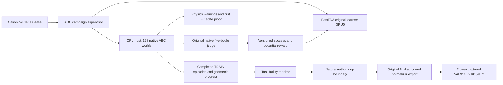

# FastTD3 ABC reward-v2 campaign

This campaign trains the original FastTD3 state policy from scratch in 128 native ABC YAM worlds. It uses the original 12 author modules and the existing learner, replay, actor, critic, normalizer and read-only update observer. The new adapter changes the task reward and the training budget. This is an ABC task-transfer diagnostic. It is not a paper reproduction or an R1Lite result.

The native task judge stays unchanged. Sparse success pays 1 only when all five bottles are currently in the bin and the task terminates. The dense profile adds `0.99 * Phi(next) - Phi(previous)`, with `Phi <= 0.25`. True termination uses a final potential of zero. A time limit retains the actual final potential because the author critic bootstraps timeouts. The host computes this transition before it resets the world. It reports the original fractional reward, sparse reward, shaping reward and learner reward separately.

The potential uses geometric reach, lift clearance and transport. It does not measure a grasp or contact. The length and weight choices are explicit versioned heuristics. They have not been tuned on VAL. The host computes FK in owned scratch data. It records a first proof for each rank: exact native INTEGRATION bytes before and after, independent qpos-derived bottle COM and site comparisons, model/config hashes, bounded potential and snapshot latency. The original native evaluator runs only through the original control path. A separate public evaluator reads copied reset qpos once to obtain geometry metadata.

The short `runtime_gate` has 64 vector calls, or 8,192 transitions. It tests native reward, physics, source and learner integrity. It makes no claim about task learning. The long `training` phase has a declared maximum of 42,480 calls, or 5,437,440 transitions. It cannot stop for task futility before 21,240 calls and six completed native episodes per rank. It checks complete TRAIN episode windows every 3,540 calls. After the minimum, three consecutive complete windows without meaningful improvement can end training. The earliest such stop is 31,860 calls when each rank takes the full task horizon.

A meaningful improvement reaches at least one recorded threshold relative to the previous best: success rate `1/128`, final bottles `0.1`, peak bottles `0.1`, peak potential `0.005`, peak mean reach `0.02`, peak mean lift clearance `0.02`, or peak mean lift-times-transport `0.02`. Each window gives equal weight to each rank and averages its completed episodes first. The host records final and peak values separately. An incomplete window breaks the stale-window sequence. No loss or VAL score controls the stop.

The monitor changes only the finite loop bound after a successful environment call. The current author iteration still inserts replay and runs every scheduled update. The next normal loop condition exits. The unchanged author final save then publishes the actual step count. The receipt records both the initial maximum arguments and the effective final arguments. The original learning-rate start and end values are equal, so the prebuilt scheduler stays constant. There are no periodic-save label changes. The export omits optimizer, replay and RNG resume state.

For `S` completed vector calls, the author schedule gives `128*S` transitions, `2*(S-11)` critic updates and `S-11` actor updates. Batch32,768, replay51,200, gamma0.99, AMPbf16, compile and the author defaults stay unchanged. Gamma0.99 has an effective horizon near100 ABC controls, or3.4seconds. TRAIN demonstrations take1,037–1,410controls. This is a known transfer limitation. Local potential progress does not guarantee full-task learning.

The new profile fails on BADQPOS, BADQVEL, BADQACC, BADCTRL, nonfinite physics or an internal time reset. Benign warning counters stay visible. The host keeps one pre-control INTEGRATION state in RAM. On failure it saves rank, seed, control, action, warning counters, the original compiled MJB and exact pre/post state once. It does not write a state file for every control. Signals and numerical failures remain failed jobs. They cannot be reported as a task-futility stop.

The stage runs only under the canonical lease. It uses two normal installed Python environments, a private0700 Unix socket directory, bounded startup/RPC/learner/shutdown timeouts and the same process group. It requires both direct children and all128 native workers to exit cleanly. The long input is generated only after the actual short gate completes. Its memory floor uses measured gate resources.

The separate frozen supervisor admits a completed canonical long producer, its actual native episode evidence and its authenticated final export. It uses the existing captured-scene gates and adapter evaluation loop with the original actor and normalizer. It runs no updates. Its only declared VAL seeds are9100,9101,9102. It keeps real native videos and task scores. Sparse success shares EXPO's full-task objective, but observations, initialization and actions remain unmatched. A performance change against the historical4,000-call result cannot be attributed to reward alone because both reward and budget changed.

Historical qualification64, scratch4000 and frozen4000 modules and receipts stay unchanged. This release adds separate modules and profiles. CPU tests use explicit doubles; actual native FK, physics, memory and GPU acceptance belong to the root-owned short canonical gate.
