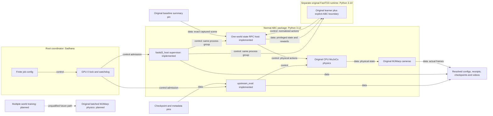

# Original ABC baseline and FastTD3 diagnostic contract

The baseline worker calls the original `abc_minimal.eval_policy.run_eval`.
It uses the original `SimEvalConfig` and the pinned checkpoint metadata.
Original source files stay unchanged.
This document uses STE guidance. A full ASD-STE100 compliance check was not done.

The root owns GPU admission, package installation, native runs, and result acceptance.
The ABC worker owner implements the simulator boundary and CPU tests.
The FastTD3 owner installs the original learner in its separate runtime.
The EXPO owner implements a separate image and physical-action boundary.
The coordinator owns independent source review and publication.

The baseline configuration uses one world, seed `20260511`, and at most 3,540 controls.
It uses 236 chunks, 15 executed controls, ten diffusion steps, RTC prefix four, and lead four.
It retains `fast_inference=True` and `fast_compile_mode=max-autotune`.
It uses the explicit training prompt `sim throw plastic bottles in bin`.
Its original five-world default is reduced to one world.
This qualification does not reproduce the complete published benchmark.
The receipt records resource environment overrides and hashes the original summary and video.
The resolved configuration comes from the original summary.
Video rendering contributes to the RTC timing measurements.

The FastTD3 worker starts two children in the coordinator process group.
One child runs the original simulator in the ABC runtime.
The other child runs the installed original FastTD3 command in its Python 3.10 runtime.
The worker requires a live GPU 0 lease before native imports.
It records module snapshots, source and asset hashes, stage commands, and finite deadlines.
The learner output directory is new.
Its configured compile and AMP settings are explicit.
Compiler caches stay in the task output tree.

The first training configuration uses one world and 64 learner steps.
It retains the original batch size of 32,768 and replay capacity of 51,200.
Original learner math and architecture stay in the original package.
This short run qualifies the boundary. It does not establish a reliable method ranking.

The Unix socket directory has mode `0700`. The socket has mode `0600`.
Each connection carries one newline-delimited JSON request and response.
Each frame is at most four MiB.
The schema is `sadhana.fasttd3.abc.v1`.
Requests contain `schema`, a positive integer `id`, and `operation`.
Operations are `describe`, `reset`, `step`, and supervisor `shutdown`.
Successful responses contain `schema`, `id`, `ok:true`, and object `result`.
Rejected requests contain `ok:false` and an error description.

`describe` returns `num_envs=1`, `num_actions=14`, `num_obs`, and a finite `max_episode_steps`.
It also returns `privileged_state=true` and the observation and action schemas.
The float32 observation order is full original `qpos`, full original `qvel`, and five active masks.
It then contains five variant one-hot vectors and six scale factors.
The variant vocabulary is `bottle_0` through `bottle_18`.
The scale order is bottles one through five, then the bin.
Missing scale perturbations use the original factor one.
Scene metadata records joint names, coordinate addresses, body transforms, and geometry sizes.
Free-joint quaternion order is `wxyz`.
Positions use metres. Joint angles use radians. Velocities use the corresponding SI units.
The original learner performs its own observation normalization.
This privileged state supplies information that the RGB baseline policy does not receive.

The action order is left joints one through six, left gripper, right joints, then right gripper.
Each normalized value is clipped to `[-1,1]`.
The host records each clipped component.
Joint targets use the original model's physical joint ranges.
The mapping is `low + (u + 1) * 0.5 * (high - low)` after clipping.
Gripper targets use the original policy fraction `[0,1]`.
The original environment converts this fraction to `[0,0.0475]` metres.
The XML's wider actuator limit does not change the original gripper conversion.

`reset` receives exactly one nonnegative seed.
It returns `obs`, `actual_seeds`, and object metadata.
The host clears carried arm state before each original reset.
Training layouts use the declared fixed-five scene with variants and scales disabled.
This changes the original default scene distribution.
Equal seeds do not imply equal scenes when reset options change random-number consumption.

Frozen matched evaluation requires a hash-pinned original summary and world index.
For its recorded seed, the host uses the untouched original default sampler.
It compares the full reset `RandomizationState` with the captured baseline state before any action.
Mismatch fails the request.
The per-reset record saves the actual randomization, initial observation, and physical description.
Other seeds use the fixed-five diagnostic distribution and carry `fixed_five_diagnostic` labels.
Only the bound reference seed carries `matched_baseline`.
This equality check still needs native execution evidence before a scene match is accepted.

`step` receives finite normalized actions shaped `[1,14]`.
It returns `obs`, `terminal_obs`, `rewards`, `terminated`, `truncated`, and `episodes`.
`terminal_obs` is copied after the action and before automatic reset.
For a completed episode, `obs` contains the new episode state.
Success takes precedence over a timeout at the horizon.
The original learner bootstraps timeouts from the preserved final observation.
Complete episode records contain the requested seed, success, controls, and native task evidence.
Automatic-reset seed records remain available in the host receipt.
No multiple-world reset behavior is implemented.

CPU tests use explicit doubles for native physics, learner processes, and artifacts.
They check action mapping, scene binding, reset ordering, flags, validation, transport, and cleanup.
These tests provide software boundary evidence. They provide no simulator score.
The coordinator must run the installed package and accept actual native evidence separately.
The original FastTD3 checkpoint supports export or approximate restart.
It does not contain optimizer, replay, and random-number state for exact resume.
